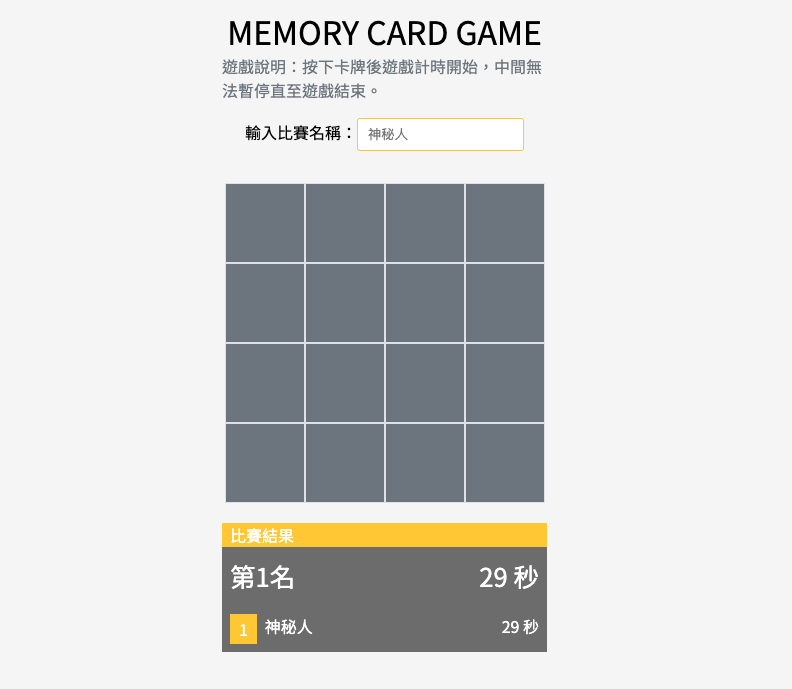

# Memory Card Game

A memory card game created using Vite React.
Project: [DEMO](https://roroiii.github.io/memory-card-game-vite/)

This is a small game called "Memory Card Game." In the game, cards are shuffled and randomly arranged on the screen. Players need to click on two cards to see if they match. If the two cards match, they will remain flipped open; if not, the cards will flip back to their original state. The goal of the game is to find all matching card pairs in the shortest time possible.

### User Story

1. As a user, I want to be able to automatically flip cards.
2. As a user, I want to be able to click on two cards to see if they match. If they match, the cards should remain flipped; if they don't match, the cards should flip back to their original state.
3. As a user, I want to have a "Play Again" button after completing the game.

ϵ( 'Θ' )϶

### Deploy

Clone the project to your local.

`yarn`
`yarn dev`

### GitHub Pages Deployment

This project is deployed using GitHub Pages.

1. Push changes to `main`
2. GitHub Actions workflow at `.github/workflows/static.yml` will install dependencies and run `yarn build`
3. The built static site in `dist/` is published to GitHub Pages automatically

# 記憶卡牌小遊戲

使用 Vite React 製作的記憶卡牌小遊戲。
專案： [DEMO](https://roroiii.github.io/memory-card-game-vite/)

這是一款名為「記憶卡牌遊戲」的小遊戲。在遊戲中，卡片會被打亂並隨機排列在螢幕上。玩家需要點擊兩張卡片以檢視它們是否相符。如果兩張卡片相符，它們將保持翻開狀態；如果不相符，卡片將會翻回原狀。遊戲的目標是在最短的時間內找出所有匹配的卡片組合。

### 使用者故事

1. 身為一位使用者，我希望可以自動蓋牌。
2. 身為一位使用者，我希望可以點擊兩張卡片來檢視它們是否相符。若相符，卡片便保持翻開；若不符，卡片則會翻回原狀。
3. 身為一位使用者，我希望可以破解遊戲後有一顆再玩一次的按鈕。
4. 身為一位使用者，我希望可以記錄我的分數與排名，並看到其他人的分數。

ᶘ ᵒᴥᵒᶅ

### 部署

clone 專案至本地端

`yarn`
`yarn dev`

### GitHub Pages 部署

本專案改用 GitHub Pages 部署：

1. 將程式碼 push 到 `main`
2. GitHub Actions（`.github/workflows/static.yml`）會自動安裝相依套件並執行 `yarn build`
3. 將 `dist/` 靜態檔自動發佈到 GitHub Pages
